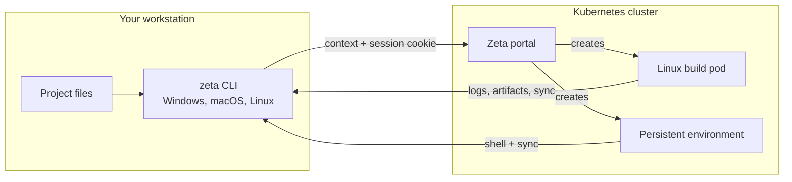

# Developer overview

Zeta lets you build and debug projects in the cluster without a kubeconfig. You
use a single binary, `zeta`, from Windows, macOS, or Linux. Builds always run in
Linux pods.

The platform team installs the portal and the build images. See
[Platform overview](../platform/index.md). You only need the CLI and a login.

## Install the CLI

Linux and macOS:

```bash
curl -fsSL https://raw.githubusercontent.com/SlimaineB/zeta/main/scripts/install-cli.sh | sh
```

Windows PowerShell:

```powershell
irm https://raw.githubusercontent.com/SlimaineB/zeta/main/scripts/install-cli.ps1 | iex
```

The installers download the matching binary from the latest GitHub Release,
verify `checksums.txt`, and put `zeta` on your `PATH`. See
[Install the CLI](installation.md) for pinned versions and manual downloads.

## How it works



- The CLI packages the local context and uploads it; no Git remote is required.
- The portal creates a Job with the selected profile image.
- Logs stream live; artifacts come back as an archive.
- `zeta build --sync` mirrors your local directory into the pod and back.
- Persistent environments stay available between commands and scale to zero when
  idle.

## First commands

```bash
zeta login --server http://zeta.local --email dev@example.com --password dev
cd my-project
zeta build
```

If you use the example Git server:

```bash
zeta build --git --profile go \
  --repo git://git-server/go.git \
  --commit main
```

## Next steps

- [Install the CLI](installation.md)
- [First build](../getting-started/quickstart.md)
- [CLI guide](../user-guide/cli.md)
- [Builds and sync](../user-guide/builds.md)
- [Persistent environments](../user-guide/environments.md)
- [Build profiles](../user-guide/profiles.md)
