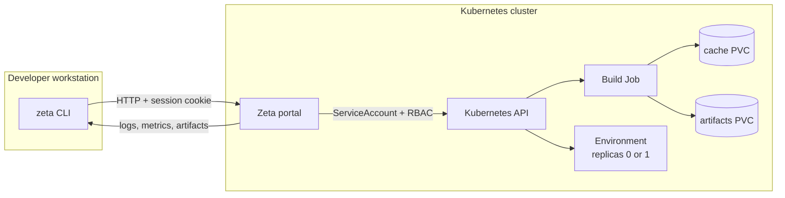

# Zeta

**Zeta** is a Kubernetes build portal for developers **without user kubeconfigs**.
Developers submit builds from their workstation with the `zeta` CLI. The portal
runs inside the cluster, creates Kubernetes Jobs with its own ServiceAccount, and
streams logs, metrics, artifacts, and optional bidirectional workspace sync back
to the CLI.

The web UI is a monitoring dashboard, not a build form.

<div class="grid cards" markdown>

-   :material-server-network:{ .lg .middle } **Operate the platform**

    ---

    Install the portal with Helm, configure OIDC and storage, and run upgrades.

    [:octicons-arrow-right-24: Platform overview](platform/index.md)

-   :material-laptop:{ .lg .middle } **Build with Zeta**

    ---

    Install the CLI with `curl | sh` or PowerShell, then build without a kubeconfig.

    [:octicons-arrow-right-24: Developer overview](developer/index.md)

-   :material-console:{ .lg .middle } **Use the CLI**

    ---

    Local or Git builds, live logs, artifacts, volumes, and environments.

    [:octicons-arrow-right-24: CLI guide](user-guide/cli.md)

-   :material-sitemap:{ .lg .middle } **Understand the architecture**

    ---

    Control plane, execution plane, Jobs, PVCs, and the sync hub.

    [:octicons-arrow-right-24: Architecture](reference/architecture.md)

</div>

## Quick start

=== "Platform team"

    ```bash
    helm upgrade --install zeta oci://ghcr.io/slimaineb/charts/zeta \
      --version 0.1.0 \
      --namespace zeta-poc --create-namespace \
      --set ingress.host=zeta.local
    ```

    See [Install the platform](platform/installation.md).

=== "Developer"

    ```bash
    curl -fsSL https://raw.githubusercontent.com/SlimaineB/zeta/main/scripts/install-cli.sh | sh
    zeta login --server http://zeta.local --email dev@example.com --password dev
    cd my-project
    zeta build
    ```

    On Windows:

    ```powershell
    irm https://raw.githubusercontent.com/SlimaineB/zeta/main/scripts/install-cli.ps1 | iex
    ```

    See [Install the CLI](developer/installation.md).

## What Zeta gives you

- **Compute on demand.** One of the main goals of Zeta is to avoid keeping a
  powerful workstation or build server running all the time. Builds run in
  short-lived Kubernetes Jobs, so CPU and memory are used only while a build is
  running. Persistent environments scale to zero when idle.
- **Zero Kubernetes onboarding.** No kubeconfig, no namespace access, no
  `kubectl` knowledge required.
- **Reproducible environments.** Every build uses a pinned image and profile, so
  local machine differences do not affect the result.
- **Isolation.** Builds run as non-root Jobs under `restricted` Pod Security,
  without service account tokens.
- **Fast feedback.** Logs stream live, caches persist between builds, and
  artifacts are downloaded automatically.
- **Flexible source input.** Use the local working tree by default, or a pushed
  Git commit when you need an auditable revision.
- **Interactive debugging.** `--sync` mirrors your local code into the build pod
  and brings produced files back.
- **Persistent dev environments.** `zeta activate` opens a shell in a pod that
  stays available between commands, backed by a persistent volume.
- **Extensible.** A new language is a YAML profile plus an image, not a control
  plane change.

## High-level view



The build Job is ephemeral: it is created when you run `zeta build` and removed
after completion. Only the cache and artifacts PVCs remain.

For persistent environments, the workload is not an ephemeral Job:

```text
zeta CLI  <--- WebSocket --->  portal sync hub  <--- WebSocket --->  syncd
       |                                                                |
       |  interactive shell (exec)                                      v
       `------------------------------------------------------>  /workspace (PVC)
```

## What Zeta is not

- It is not a full CI/CD system with SCM webhooks, pipelines, approvals, and
  deployment stages.
- It does not provide per-group RBAC or strong multi-tenant isolation yet.
- It does not build or push OCI images; it produces build artifacts on a PVC.
- It is not a remote cache or a distributed build system for very large
  monorepos.

## Project status

Zeta is under active development and is validated on a single-node k3s
cluster (WSL2). The following are implemented and tested:

- local and Git builds, C++/Python/Go profiles, persistent caches;
- artifacts, metrics, web dashboard, and HTTP API;
- persistent environments with shell, file sync, and idle scale-down;
- volume quotas, resize, and deletion;
- dev and OIDC authentication.

Known limitations are documented in [Security](operations/security.md) and
[Troubleshooting](operations/troubleshooting.md).

## Documentation

- [Platform overview](platform/index.md)
- [Install the platform](platform/installation.md)
- [Helm chart reference](platform/helm-chart.md)
- [Developer overview](developer/index.md)
- [Install the CLI](developer/installation.md)
- [First build](getting-started/quickstart.md)
- [`zeta.yaml` reference](reference/zeta-yaml.md)
- [HTTP API](reference/api.md)
