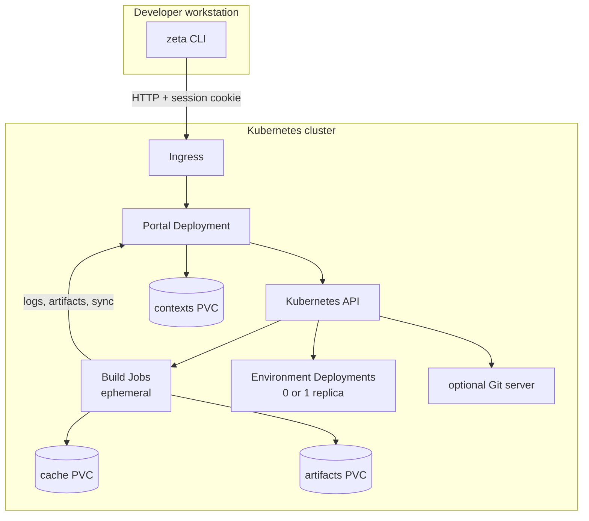

# Platform overview

This section is for the team that operates the Kubernetes cluster. Developers
only need the [CLI](../developer/index.md); they do not need a kubeconfig, a
namespace, or `kubectl`.

Zeta runs as a normal Kubernetes Deployment. The portal owns the build
namespace, creates short-lived Jobs, and exposes a small HTTP API and dashboard.
The platform team installs and upgrades it with Helm.

## What you deploy

| Component | Managed by | Purpose |
|---|---|---|
| Portal Deployment | Helm | API, authentication, dashboard, Job creation |
| Service and Ingress | Helm | HTTPS entry point |
| RBAC | Helm | Namespace-scoped access to Jobs, Pods, logs, and PVCs |
| Shared PVCs | Helm | Cache, artifacts, and uploaded contexts |
| Build images | Release pipeline | C++, Go, Python/uv, Git server, portal/syncd |
| Optional Git server | Helm | Example repositories for Git-mode builds |

The chart keeps the resource names stable: the portal is `zeta-portal`, the
Git server Service is `git-server`, and the PVCs are `zeta-poc-artifacts`,
`zeta-poc-cache`, and `zeta-poc-contexts`. Profiles and the CLI rely on these
names.

## Compute on demand

One of the main goals of Zeta is to avoid keeping a powerful build workstation
or CI server running all the time. A small shared cluster is enough:

- a build runs in an ephemeral Job and releases its CPU and memory when it
  finishes;
- caches and artifacts stay on PVCs, not on always-on build machines;
- persistent environments scale to zero when no shell or sync client is
  attached, then resume from the same volume.



Only the portal, the optional Git server, and the PVCs remain after a build.

## Install the platform

The published chart already points at the GHCR images:

```bash
helm upgrade --install zeta oci://ghcr.io/slimaineb/charts/zeta \
  --version 0.1.0 \
  --namespace zeta-poc --create-namespace \
  --set ingress.host=zeta.local
```

If your cluster does not use Traefik or `local-path` storage:

```bash
helm upgrade --install zeta oci://ghcr.io/slimaineb/charts/zeta \
  --version 0.1.0 \
  --namespace zeta-poc --create-namespace \
  --set ingress.className=nginx \
  --set ingress.host=zeta.example.com \
  --set portal.storageClass=gp3
```

Then point `zeta.local` (or your host) at the ingress address:

```bash
kubectl -n zeta-poc get ingress zeta-portal
```

The default development login is `dev@example.com` / `dev`. For production,
configure OIDC and a fixed session key. See the
[Helm chart reference](helm-chart.md).

## Install from source

For local development or a k3s cluster without a registry, the smart installer
builds the images, imports them into k3s, and runs the same Helm chart:

```bash
./scripts/install.sh
```

Useful variants:

```bash
./scripts/install.sh --with-git-server
./scripts/install.sh --adopt        # migrate an existing raw install
./scripts/install.sh --dry-run      # print the Helm command only
```

The installer is idempotent. `make install-smart` is the same command.

## Next steps

- [Install the platform](installation.md)
- [Helm chart reference](helm-chart.md)
- [Deployment and operations](../operations/deployment.md)
- [Security model](../operations/security.md)
- [Developer documentation](../developer/index.md)
