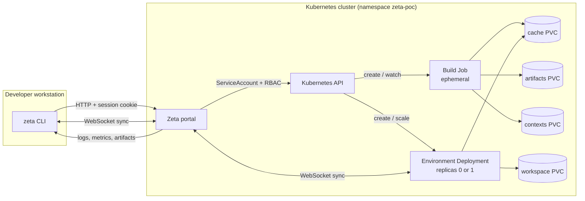

# Architecture

Zeta separates the **control plane** from the **execution plane**. The portal
never compiles user code; it creates and observes Kubernetes workloads. Builds
and environments run in isolated pods with their own volumes and security
context.



The control plane is small and always available. The execution plane is
short-lived: a build exists only for the duration of a Job, and an environment
is scaled to zero when idle.

## Control plane vs execution plane

| Layer | Runs where | Responsibility |
|---|---|---|
| `zeta` CLI | Developer workstation | Package the context, call the API, stream logs, receive artifacts, run sync |
| Portal | Kubernetes namespace | Authenticate users, validate requests, resolve profiles, create Jobs and Deployments, relay logs/artifacts/sync |
| Kubernetes | Cluster | Schedule and isolate pods, mount PVCs, enforce RBAC and Pod Security |
| Build images | Cluster nodes | Provide compilers, package managers, Git, and profile-specific toolchains |

## Components

| Component | Role |
|---|---|
| `portal` | REST API, dev/OIDC auth, embedded web UI, Kubernetes workload creation |
| `zeta` CLI | Login, build submission, logs, status, metrics, artifacts, environments |
| Git server | Optional example server with `cpp.git`, `python-uv.git`, `go.git` |
| Build Job | Extracts context or clones Git, runs profile commands, writes `/artifacts` |
| Environment Deployment | Long-lived pod with a workspace PVC, a shell, and a sync sidecar |
| Cache PVC | Persistent `ccache`, `uv`, and Go module/build caches |
| Context PVC | Uploaded `tar.gz` contexts for local-context builds |
| Artifacts PVC | Build outputs shared between Jobs and the portal |

Kubernetes resources:

- Namespace: `zeta-poc`
- Pod Security Admission: `restricted`
- Build Jobs: non-root `1000:1000`, no service account token, seccomp
  `RuntimeDefault`, all capabilities dropped
- Portal: non-root `65532:65532`, read-only root filesystem
- Portal RBAC: namespace-scoped access to Jobs, Pods, Pod logs, and PVCs

## Request flow: build

1. The developer runs `zeta build` from a project directory.
2. The CLI detects the profile, builds a filtered `tar.gz` context, and uploads
   it to the portal with the session cookie.
3. The portal validates the archive, stores it on the context PVC, and creates a
   Job.
4. The Job init container extracts the context into `/workspace` (or clones the
   requested Git commit in Git mode).
5. The build container runs the profile commands with `/cache` and `/artifacts`
   mounted.
6. The portal streams logs and status to the CLI and web UI.
7. When the Job succeeds, the CLI downloads the artifacts as a `.tar` archive.
8. The Job and its pod are removed automatically after the configured TTL.

```text
zeta CLI
   |
   |  POST /api/builds (multipart or JSON)
   v
portal ──► create Job ──► init (context/Git) ──► build (profile commands)
   |                                                    |
   |  GET /api/builds/{id}/logs                          ├── /cache (PVC)
   |  GET /api/builds/{id}/metrics                       └── /artifacts (PVC)
   |  GET /api/builds/{id}/artifact
   v
zeta CLI
```

## Build Job anatomy

| Part | Purpose |
|---|---|
| `context` init container | Extracts the uploaded `tar.gz` or clones the Git commit |
| `build` container | Runs the profile `commands` in `workDir` |
| `syncd` sidecar | Only for `--sync`; relays workspace changes |
| `/workspace` | EmptyDir or context volume used by the build |
| `/cache` | Shared or dedicated cache PVC |
| `/artifacts` | Shared or dedicated artifacts PVC |

Security:

- `runAsNonRoot`, UID/GID `1000:1000`;
- `automountServiceAccountToken: false`;
- `seccompProfile: RuntimeDefault`;
- all capabilities dropped;
- `ActiveDeadlineSeconds` and `TTLSecondsAfterFinished` bound the lifetime.

## Environment anatomy

An environment is a Deployment named `zeta-env-<id>` with two containers:

```text
Deployment zeta-env-<id> (replicas 0 or 1)
  |- env   : profile image, command "sleep infinity", workingDir /workspace
  |          mounts: /workspace (PVC zeta-env-<id>), /cache (shared cache PVC)
  `- syncd : image zeta/portal:0.1, command /syncd
             env: ZETA_SYNC_TOKEN (Secret zeta-env-<id>-sync),
                  ZETA_SYNC_URL=ws://zeta-portal/api/sync/<id>/agent,
                  ZETA_WORKSPACE=/workspace,
                  ZETA_SYNC_ENV=1
             mounts: /workspace
```

The sync Secret is created by `zeta init` and reused by later activations. If the
Secret is missing when the portal needs a session, it recreates it from the
Deployment token.

## Sync hub

The portal keeps an in-memory hub keyed by environment or build ID. Each session
holds:

- the sync token;
- the CLI and agent WebSocket connections;
- activity timestamps for clients and exec sessions.

The hub relays messages between the CLI and the `syncd` sidecar. Activity
tracking is also used by the idle reaper.

## Exec proxy

`GET /api/envs/{id}/exec` upgrades to a WebSocket and runs a TTY command through
the Kubernetes exec API (`remotecommand.NewWebSocketExecutor`).

Frame format:

| First byte | Direction | Payload |
|---|---|---|
| `i` | client → server | Raw stdin |
| `r` | client → server | JSON resize `{"cols":80,"rows":24}` |
| `o` | server → client | Raw stdout/stderr |

The shell is non-login and starts in `/workspace`:

```sh
sh -c "cd /workspace && (command -v bash >/dev/null && exec bash -i || exec sh -i)"
```

## Idle reaper

`RunIdleReaper` periodically scans active environments:

1. tick interval is `min(timeout, 1m)`;
2. an environment with an attached client or exec is never reaped;
3. an environment idle for `--env-idle-timeout` is scaled to zero;
4. its sync session is deleted and forgotten;
5. the workspace PVC is preserved.

`--env-idle-timeout=0` disables the reaper. The default is `15m`.

## Deletion

`DeleteEnvironment` deletes the Deployment, pods, sync Secret, and PVC with
bounded waits:

- 45 seconds for pods;
- 60 seconds for the PVC.

If the PVC is still terminating, the API returns an error explaining that the
environment was removed but its volume is still terminating.

## Data model

| Type | Key fields |
|---|---|
| `Build` | id, profile, language, repo, commit, owner, status, pod, timestamps, durations, cache metrics |
| `Profile` | name, language, image, commands, artifactPath, cacheDir, PVCs, resources, env, metrics |
| `Volume` | name, role, capacity, storageClass, createdAt, last use, inUse, resizable |
| `Environment` | id, profile, owner, active, sizeBytes, storageClass, createdAt |
| `EnvSpec` / `EnvRequest` | id/name, profile, owner, image, env, size, token |

## Design choices

- **Local context first.** The default mode works without a Git remote, a
  webhook, or a pushed commit.
- **Git mode when reproducibility matters.** Passing `--git` or `--repo` builds
  an exact commit reachable from the cluster.
- **Profiles instead of hard-coded languages.** A profile is an image, commands,
  resources, environment, and metrics. Adding a language does not change the API.
- **Persistent caches, ephemeral builds.** PVCs are mounted only while a pod
  runs; after the Job is deleted, only storage remains.
- **No user cluster credentials.** Authentication and authorization happen at
  the portal.
- **Observable by default.** Logs, durations, cache metrics, and artifacts are
  exposed through the same API used by the CLI and dashboard.

## Compute on demand

One of the main goals of Zeta is to avoid keeping a powerful build machine
running all the time. You do not need a high-end laptop, a dedicated build
server, or a large always-on VM for every developer.

Instead:

- the control plane is a small portal Deployment that can run on an inexpensive
  always-on node;
- build compute is requested only while a build Job is running, then released;
- CPU and memory limits are set per profile, so heavy C++ or Go builds do not
  affect other workloads;
- persistent environments are scaled to zero after
  `--env-idle-timeout` (default `15m`) and resume from their workspace PVC;
- caches survive between builds, so paying for compute on demand does not mean
  rebuilding everything from scratch.

The result is a shared build capacity model: expensive CPU and memory are
consumed in bursts, when someone actually needs them, instead of being idle on
a developer workstation all day.

## Failure and recovery

- **Portal restart:** sync sessions are in memory and are recreated from the
  Secret when needed. OIDC login flow state is stored in a signed `zeta_oidc`
  cookie, so it survives portal restarts and works across replicas. Sessions are
  invalidated if `--oidc-session-key` is random.
- **Idle environment:** scaled to zero; `zeta activate` starts it again with the
  same volume.
- **Stuck build:** `ActiveDeadlineSeconds` terminates it; the TTL removes it.
- **Lost node (local-path):** the PVC is node-local; use an EBS-backed
  StorageClass for durability.
